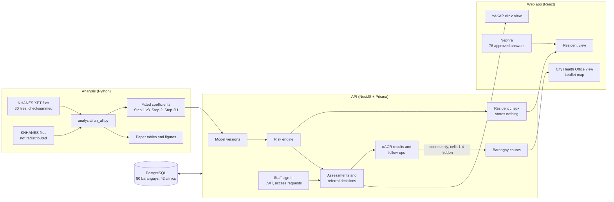

<div align="center">


# NEPHLUX

**Machine Learning–Based Albuminuria Risk Stratification from PhilHealth YAKAP Labs for Early Kidney Damage**

*Who should get the kidney test first?*

PhilHealth's YAKAP primary care benefit already pays for HbA1c, creatinine, lipids, a blood count and a urinalysis, but not the urine albumin test (uACR) that finds kidney damage early. NEPHLUX turns the results a YAKAP clinic already has, including the urine dipstick, into one ranking of who needs that test first. Residents, YAKAP clinics and the City Health Office each get their own part of one web app, set in Cagayan de Oro City: 80 barangays and 42 YAKAP clinics.

[](#)
[](#)
[](#architecture)
[](#results-against-the-pass-mark)
[](LICENSE)
[](https://incidents.betterstack.com/?utm_source=status_badge)

[Live demo](https://nephlux-pjdsc-2026.vercel.app) · [Pitch deck (PDF)](docs/NEPHLUX_Pitch_Deck.pdf) · [Project paper (PDF)](docs/NEPHLUX_Paper.pdf) · [Run the app](#run-the-app) · [Video Demonstration](https://drive.google.com/file/d/1bPF_NGT99oGV1Vj8wCW6Cy9ghxx8G02B/view?usp=sharing)

<br/>


</div>

<br/>

| **+94** | **0.917** | **4 of 4** | **80%** |
|:---:|:---:|:---:|:---:|
| more kidney cases found than today's rule, with the same number of uACR tests | AUROC on 11,047 adults from a national health survey | pass-mark criteria met, each written before the test data were opened | of cases with no diabetes and no high blood pressure caught, against 34% for today's rule |

<details>
<summary><b>Table of contents</b></summary>

1. [Overview](#overview)
2. [The Problem](#the-problem)
3. [The Gap](#the-gap)
4. [The Solution: Rank Who Gets the uACR Test](#the-solution-rank-who-gets-the-uacr-test)
5. [Data and Methods](#data-and-methods)
6. [Results Against the Pass Mark](#results-against-the-pass-mark)
7. [Who the Rule Misses](#who-the-rule-misses)
8. [When Tests Are Scarce](#when-tests-are-scarce)
9. [Earlier Results: Step 2 on U.S. Data](#earlier-results-step-2-on-us-data)
10. [The App](#the-app)
11. [Who It Serves](#who-it-serves)
12. [Nephra, the Help Assistant](#nephra-the-help-assistant)
13. [Privacy and Safety by Design](#privacy-and-safety-by-design)
14. [How It's Different](#how-its-different)
15. [Limitations and Next Steps](#limitations-and-next-steps)
16. [Architecture](#architecture)
17. [Repository Contents](#repository-contents)
18. [Run the App](#run-the-app)
19. [Reproducibility](#reproducibility)
20. [Photo Credits](#photo-credits)
21. [References](#references)
22. [License](#license)

</details>

---

## Overview

Chronic kidney disease (CKD) is often found only when dialysis is the last option left. The earliest sign, albumin in the urine, is measured by the urine albumin-creatinine ratio (uACR). YAKAP does not cover that test, but it does cover tests that carry real information about the kidneys, including the urine dipstick.

NEPHLUX works in two places:

1. **At home (Step 1).** A 10-question resident check with no labs. It raises awareness and brings people to a YAKAP check-up. It never sorts them.
2. **At the YAKAP clinic (Step 2U).** A nurse or doctor enters the blood pressure, the YAKAP blood tests and the urine dipstick. A logistic regression model estimates the chance of uACR ≥30 mg/g and shows its top reasons. The doctor decides who gets the urine test.

We wrote each pass mark before the data it judges were opened. Step 2U met all four of its criteria on a clean Korean test set.

| Metric | Value |
|---|---|
| **Cases found vs. today's rule, same number of uACR tests** | **+94** (95% CI +72 to +118) |
| **Step 2U AUROC** | 0.917 (95% CI 0.909–0.926) |
| **Calibration slope** | 1.02 (0.96–1.07) |
| **Tested on** | 11,047 Korean adults (KNHANES 2019–2020), scored once |

*"Today's rule" means referring everyone with diabetes, high blood pressure or a dipstick protein of 1+, which is what a clinic could already do with the dipstick it has.*

NEPHLUX supports the doctor's decision and does not diagnose. Step 2U was learned and tested on Korea's national health survey (KNHANES), and Step 2 on the U.S. survey (NHANES). The next test is on YAKAP records in Cagayan de Oro (see [Next steps](#limitations-and-next-steps)). NEPHLUX is not affiliated with or endorsed by PhilHealth.

---

## The Problem


<br/>

Hemodialysis was PhilHealth's top-paid medical procedure in fiscal year 2024 (Philippine Health Insurance Corporation [PhilHealth], 2025). Since October 2024, PhilHealth pays ₱6,350 a session for up to 156 sessions a year, or **₱990,600 per patient per year** (PhilHealth, 2024b). Fewer than 10% of Filipino adults had been diagnosed with CKD in 2021, the Philippine Society of Nephrology said (Orejas, 2024).


<br/>

No published source gives CKD burden by Philippine city or barangay. The nearest local evidence is one hospital. At Northern Mindanao Medical Center, 1,207 of 32,378 adult admissions (May 2024 to May 2025) had CKD:

| Finding | Value |
|---|---|
| CKD admissions from Cagayan de Oro City | **580** of 1,207, more than any other city or town |
| Arrived at stage 5 | **82.4%** |
| Already on dialysis | **98.4%** |
| Leading causes | High blood pressure 35.7%, diabetes 34.8% |

*Source: Mambering & Espiga-Comonsad (2026). These are hospital admissions, not a city rate.*

---

## The Gap


<br/>

YAKAP covers a CBC, lipid profile, FBS, OGTT, HbA1c, creatinine, chest X-ray, sputum microscopy, ECG, mammogram, ultrasound, urinalysis, Pap smear, fecalysis and FOBT, as listed in the benefit table of Konsulta, YAKAP's former name (PhilHealth, 2024a). **uACR is not on the list.**

- **85%** of U.S. survey adults with uACR ≥30 mg/g had a normal-looking creatinine (eGFR ≥60).
- **24%** had neither diabetes nor high blood pressure, so the usual "refer everyone with diabetes or high BP" rule never sends them.

> **Problem statement.** A YAKAP clinic cannot send everyone for a uACR test, and has no evidence-based way to choose who goes first from the tests YAKAP already pays for.

---

## The Solution: Rank Who Gets the uACR Test


<br/>

| Step | Who | What happens | What NEPHLUX never does |
|---|---|---|---|
| 1. Resident check | Resident | 10 questions on a phone, no labs. A plain result and a 9-character clinic code. | Diagnose, or save or send the answers |
| 2. YAKAP check-up | YAKAP clinic | BP, HbA1c, creatinine, lipids, CBC and the urine dipstick YAKAP already covers. | Replace the YAKAP consult |
| 3. Step 2U model | Nurse or doctor | Chance of uACR ≥30 mg/g and its top reasons. With no dipstick result, it uses Step 2 (blood tests only). | Guess a missing lab or treat it as normal |
| 4. Doctor decides | Doctor | Approve, override with a written reason, or no referral. A dipstick protein of 1+ always means refer. | Refer anyone by itself |
| 5. uACR test and follow-up | Clinic · City Health Office | The clinic follows up its own referrals; the City Health Office sees barangay counts. | Show names to the city or claim prevalence |

**Per 100 adults** in the Korean test set, referring the same share as today's rule, Step 2U referred **39.4** for uACR and found **7.7** of the **8.3** with albuminuria.

---

## Data and Methods


<br/>

| Study Element | Methodology & Data Details |
|---|---|
| **Design** | Prediction model development with temporal and external validation, reported with TRIPOD+AI (Collins et al., 2024) |
| **Step 2U data** | Korea's national health survey (KNHANES; Korea Disease Control and Prevention Agency, n.d.), which measures the urine dipstick and uACR in the same adults. Learned on 2021–2024 (20,465 adults); tested once on 2019–2020 (11,047 adults, 912 cases, 8.3%) |
| **Step 2 data** | U.S. NHANES (Centers for Disease Control and Prevention, National Center for Health Statistics, n.d.), which has no dipstick. Trained on 2011–2016 (13,840 adults); tested once on 2017–March 2020 (6,655 adults, 797 cases) |
| **Population** | Adults 20+, not pregnant, no known kidney disease or dialysis; complete-case analysis |
| **Outcome** | A single spot uACR ≥30 mg/g |
| **Step 1 inputs** | Age, sex, told has diabetes, told has high BP, BP medicine, BMI, smoking, family history of diabetes, past heart attack, stroke or heart failure |
| **Step 2 adds** | Measured systolic and diastolic BP, HbA1c, eGFR (race-free CKD-EPI 2021; Inker et al., 2021), total and HDL cholesterol, hemoglobin, white cell count, platelets |
| **Step 2U adds** | Urine dipstick protein (trace, 1+, 2+ or more), blood, glucose and specific gravity |
| **Model** | L2-penalised logistic regression (scikit-learn; Pedregosa et al., 2011), simple on purpose so every reason can be shown to the doctor. Race was not used. |
| **Evaluation** | 1,000 bootstrap resamples; calibration slope and calibration-in-the-large (Van Calster et al., 2019); decision-curve net benefit (Vickers & Elkin, 2006); exact SHAP reasons for each prediction (Lundberg & Lee, 2017) |

**Step 2U pass mark (written before the 2019–2020 test years were opened):**

1. AUROC with its 95% CI above 0.70.
2. More cases than "diabetes, high BP or dipstick protein 1+" at the same number of referrals, with a bootstrap CI excluding 0.
3. Better than the same model without the dipstick.
4. Calibration slope between 0.8 and 1.2.

The analysis script and model were hashed (SHA-256) before the one test run.

---

## Results Against the Pass Mark


<br/>

| Criterion | Target | Result | Status |
|---|---|---|---|
| Step 2U AUROC | 95% CI above 0.70 | 0.917 (0.909–0.926) | ✅ Met |
| Cases vs. today's rule, same referrals | More, CI excludes 0 | +94 (+72 to +118) | ✅ Met |
| Better than the same model without the dipstick | Higher AUROC | +0.131 (0.116–0.147) | ✅ Met |
| Calibration slope | 0.8–1.2 | 1.02 (0.96–1.07) | ✅ Met |

Referring the same 39.4% of adults, Step 2U found **846 of 912 cases (92.8%)** against **752 (82.5%)** for today's rule.


<br/>

| Approach (KNHANES 2019–2020) | AUROC (95% CI) |
|---|---|
| **Step 2U: YAKAP labs + dipstick** | **0.917 (0.909–0.926)** |
| Same model, no dipstick | 0.786 (0.770–0.802) |
| NHANES Step 2, frozen | 0.779 (0.763–0.795) |
| Rule: diabetes, high BP or dipstick 1+ | 0.735 (0.721–0.748) |
| Rule: diabetes or high BP | 0.692 |

Mean predicted risk was 8.5% against 8.3% observed. Survey-weighted AUROC was 0.927.

**The blood tests alone are not enough.** Without the dipstick, Step 2 found fewer cases than a clinic that refers on a positive dipstick (−54; 95% CI −78 to −27). The value is in reading the dipstick and the blood tests together.

**Step 1 v3, the home check.** With a measured blood pressure and waist, the questionnaire found 17 more cases than the plain rule (95% CI +1 to +35; AUROC 0.778). With questions only it did not beat the rule (−8; −29 to +15), so the home check is for awareness only.

---

## Who the Rule Misses


<br/>

More than 1 in 4 cases in the test set had neither diabetes nor high blood pressure (244 cases). Step 2U caught **80%** of them, against **34%** for today's rule. A yes/no history question cannot find them; the dipstick and the labs can.

| Group | Today's rule | Step 2U |
|---|---|---|
| No diabetes, no high BP (244) | 34% | **80%** |
| Age 20–44 (138) | 64% | **87%** |
| Age 45–64 (312) | 75% | **88%** |
| Women (491) | 79% | **90%** |
| Men (421) | 87% | **96%** |
| Age 65+ (462) | 93% | **98%** |

*Share of cases caught at the same number of referrals (39.4%).*

---

## When Tests Are Scarce


<br/>

With only **50 uACR tests per 1,000 adults**, the NEPHLUX order found **39.7 cases** against **9.1** for today's rule (+30.6; 95% CI +28.6 to +33.0). That is about **₱755 per case found** against ₱3,281 at ₱600 a test. This is the budget view the City Health Office screen shows.

The uACR price is **assumed at ₱600** for a public or bulk purchase (range ₱300–1,200); we found no PhilHealth rate for it. Hospitals and diagnostic centers have been reported to charge **₱1,500–3,500** (Baclig, 2026); at that retail price the cost is ₱1,887–4,404 per case found against ₱8,203–19,141 for today's rule. The test is not in the YAKAP benefit. One dialysis-year is ₱990,600. These are cases found, not dialysis avoided, which depends on follow-up treatment and was not measured.

---

## Earlier Results: Step 2 on U.S. Data

Step 2, the blood-test model without a dipstick, was the first model built. On the untouched NHANES 2017–March 2020 test set it passed its own pass mark, written on 17 October 2026 before any data were downloaded:

| Criterion | Target | Result | Status |
|---|---|---|---|
| Step 2 AUROC | 95% CI above 0.70 | 0.757 (0.737–0.775) | ✅ Pass |
| Step 2 cases vs. diabetes-or-high-BP rule, same referrals | More, CI excludes 0 | +32 (+12 to +51) | ✅ Pass |
| Step 2 calibration slope | 0.8–1.2 | 0.95 (0.87–1.02) | ✅ Pass |
| Step 1 (no labs, awareness only) ranks risk better than the rule: AUROC 0.72 vs 0.66 | 95% CI above 0.70 | 0.718 (0.699–0.737); the lower bound reached 0.699 | ⚪ Just under bar |
| Step 1 finds as many cases as the rule at the same referrals (608 vs 609) | More, CI excludes 0 | −1 (−18 to +19) | 🔵 Same as rule |

Step 1 is the resident check, awareness only; it never refers anyone. As designed: with 10 questions and no labs, the check finds as many cases as the diabetes-or-high-BP rule, from a phone at home. Its job is to bring people to a YAKAP visit, where the lab model makes the referral.

On Korean adults (KNHANES 2021–2024, 20,465 adults), the frozen Step 2 still ranked well (AUROC 0.784, +28 cases) but over-predicted risk (calibration slope 1.26). That result showed that percentages need local recalibration, and that NHANES could not test the dipstick, which led to Step 2U.

---

## The App


<br/>

NEPHLUX is a web app with a React front end and a NestJS API on PostgreSQL. Residents use it with no account; YAKAP clinic and City Health Office staff sign in to their own screens. The risk models run on the server from versioned coefficients produced by the analysis script, and every screen has a light and a dark mode.

<table>
<tr>
<td width="50%"><br/><b>Landing page</b> · light mode. The pathway, the evidence and the guided demo.</td>
<td width="50%"><br/><b>Resident check</b> · dark mode. 10 questions in English, Bisaya or Tagalog. Nothing is saved.</td>
</tr>
<tr>
<td><br/><b>Patient queue</b> · light mode. Today's patients, clinic codes loaded and missing labs flagged.</td>
<td><br/><b>Assessment</b> · dark mode. Labs and dipstick in one form; the chance, the top reasons and data completeness.</td>
</tr>
<tr>
<td><br/><b>Clinic follow-up</b> · light mode. Referrals with no uACR result after 14 days, oldest first.</td>
<td><br/><b>City Health Office</b> · dark mode. 80 barangays and 42 YAKAP clinics, labelled "screening reach, not prevalence".</td>
</tr>
<tr>
<td><br/><b>Evidence</b> · light mode. A model card with each pass mark and the measured results.</td>
<td><br/><b>The doctor decides.</b> Approve, override with a reason, or decline.</td>
</tr>
</table>

*Screens show light and dark mode side by side. All patient records are SAMPLE data. The 42 YAKAP clinics come from PhilHealth's accredited list as of 30 September 2026 (PhilHealth, 2026b), and map pins are approximate.*


---

## Who It Serves


<br/>

| User | Input | Output |
|---|---|---|
| **Resident** | 10 questions, no labs | Awareness result, clinic code, nearest of 42 YAKAP clinics (YAKAP is free at public clinics, with a co-payment of up to ₱900 a year at private ones; PhilHealth, 2026a) |
| **YAKAP clinic (nurse or doctor)** | Labs YAKAP covers, BP, dipstick, history | Risk, reasons, referral slip, follow-up list. The nurse or doctor enters the data; the doctor decides. |
| **City Health Office** | Counts only | Barangay map, referral funnel, test budget slider, outreach priorities |

**From referrals to barangay screening counts.** Each clinic keeps its own records and sends the City Health Office only counts by barangay: screened, higher risk, referred, uACR done and uACR raised. Cells of 1 to 4 are hidden. Rates use the 2020 census for all 80 barangays (728,402 residents; Philippine Statistics Authority, 2021; Abdulsamad, 2026). The map shows where screening reaches, not how common CKD is.

**Next, with consent.** Each returned uACR is a Filipino record with labs, dipstick and uACR together: the data needed to test NEPHLUX on Filipinos, and a start toward a Philippine kidney dataset held by the city. Research extracts would need ethics approval, with the City Health Office as data controller under the Data Privacy Act of 2012.

---

## Nephra, the Help Assistant


<br/>

Nephra is a help chat on every screen. It picks one of **78 approved answers** about the app, YAKAP and kidney basics and stores nothing. When an AI model is set in the API's `.env`, the model may only reword the chosen approved answer, in English, Filipino or Bisaya; without one, Nephra shows the approved text as written. Questions are rate-limited per user. Danger signs get an emergency answer, and diagnosis or medicine questions are sent to the doctor.

Its pass mark was written before the answer bank existed. On held-out questions:

| Criterion | Target | Result | Status |
|---|---|---|---|
| Unsafe answers | 0 | 0 | ✅ |
| Emergency answer for every danger phrasing | All | All | ✅ |

With one "did you mean" tap, 48 of 62 (77%) reached the right answer. Nephra is labelled a **demo assistant** until it is tested on questions written by residents and clinic staff.

---

## Privacy and Safety by Design

- **The resident check stores nothing.** The server scores the answers and keeps no record or log of them. Answers reach a clinic only as the clinic code, and only if the resident shows it.
- **Nephra stores nothing.** It answers only from approved text. An optional AI model may reword that text but cannot add facts, calculate or diagnose, and the chat says when a question is sent to the AI service.
- **Staff sign in.** Clinic and City Health Office screens need an approved staff account; records use initials only.
- **Counts, not names, for the city**, with cells of 1 to 4 suppressed.
- **The doctor decides every referral.** An override requires a written reason.
- **Missing data stops the estimate.** A missing lab is never treated as normal.
- **The dipstick rule always applies.** Dipstick protein 1+ means refer, whatever the score. An eGFR under 60 raises a warning.

---

## How It's Different

| Evaluation Dimension | Diabetes-or-high-BP rule | MERWACS (Yoo et al., 2026) | **NEPHLUX** |
|---|---|---|---|
| Uses YAKAP-covered labs | ✗ | ✗ (no labs by design) | ✓ |
| Uses the YAKAP urine dipstick | ✗ | ✗ | ✓ |
| Predicts albuminuria for a uACR referral | Indirectly | Composite outcome | ✓ |
| Pass mark written before testing | — | ✗ | ✓ |
| Tested against the simple rule at equal referrals | — | ✗ | ✓ (+94 cases) |
| Barangay-level screening counts for the city | ✗ | ✗ | ✓ |

---

## Limitations and Next Steps


<br/>

**Limitations**

- **Not tested on Filipinos.** Step 2U was learned and tested on Korean adults, and Step 2 on U.S. adults. Percentages need local recalibration.
- **Dipsticks read by a laboratory.** In KNHANES the strips were read by the survey's laboratory; a YAKAP strip read by eye may do worse.
- **Local burden not measured.** The case for Cagayan de Oro rests on admissions at one hospital.
- **One uACR measurement per person.** KDIGO confirms albuminuria with repeat testing (Kidney Disease: Improving Global Outcomes [KDIGO] CKD Work Group, 2024).
- **Complete-case analysis, an assumed uACR price and no outcome follow-up.** Costs per case rise in proportion at the published retail price (₱1,500–3,500); which strategy finds more cases per test does not change.
- **Not yet used in a clinic:** clinic map pins are approximate, the Bisaya and Tagalog text awaits review by native speakers, and no clinic staff have tested the app yet.

**Next steps**

1. **Clinical review** by a YAKAP physician and a nephrologist.
2. **Walkthrough** with one YAKAP nurse or doctor on sample data, fixing what they find. A usability test across several clinics comes later.
3. **Cagayan de Oro validation:** YAKAP records with uACR from about 2,800–4,400 adults (Riley et al., 2021), with ethics approval and a data-sharing agreement. Recalibrate, then score the frozen model once.
4. **Later:** a City Health Office pilot with a fixed uACR budget in a few barangays, with their agreement.


---

## Architecture



| Layer | Technology |
|---|---|
| Modelling | Python: scikit-learn (L2 logistic regression; boosted trees as a comparison), LightGBM (Step 1 v3 trees), pandas, NumPy, SciPy, statsmodels, matplotlib, shap for checking SHAP values, pyreadstat (KNHANES SAS files), shapely (barangay map data) |
| Data | NHANES 2011–2020 (CDC), KNHANES 2019–2024 (KDCA), PSA 2020 census, PSGC 2023 boundaries (faeldon, 2024), PhilHealth YAKAP accredited list |
| Front end (`frontend/`) | React, React Router, Zustand, Tailwind CSS, Vite, Leaflet, clsx |
| API (`backend/`) | NestJS, Prisma, PostgreSQL, JWT sign-in (Passport, bcrypt), email notices (Nodemailer), Mastra for Nephra's optional AI wording, Zod |
| Monitoring | Better Stack uptime monitor for the deployed API (status badge at the top) |
| Tests | Jest for the API, including Step 2U against the Python model on 300 test patients; an axe-core accessibility scan was run on the early prototype |

---

## Repository Contents

```
NEPHLUX-PJDSC2026/
├── frontend/                   # Web app (React, Tailwind CSS, Zustand)
├── backend/                    # API (NestJS, Prisma, PostgreSQL)
├── models/                     # Step 2U and Step 1/2 coefficients, cut-offs and model card
├── analysis/                   # Python scripts that build and test every model, with pass marks
├── results/                    # Test results, figures and score logs
├── data/                       # NHANES raw files, YAKAP clinic list, census and boundaries
├── docs/
│   ├── NEPHLUX_Pitch_Deck.pdf  # 18-slide pitch deck
│   └── NEPHLUX_Paper.pdf       # Project paper
├── assets/
│   ├── logo/                   # App icon and wordmark
│   ├── pitch-deck/             # Slides 01–18 as PNG (1920×1080)
│   └── screens/                # App screenshots, light and dark mode
├── index.html                  # Early single-file design prototype
├── README.md
├── LICENSE
└── .gitignore                  # Keeps raw survey data and secrets out of the repo
```

---

## Run the App

### Quick start for judges

**Easiest: open the live demo at https://nephlux-pjdsc-2026.vercel.app** and sign in with one of the [demo accounts](#demo-accounts) below. Nothing to install.

**Or run the web app on your own computer.** The API (the web service in `backend/`) is already deployed on Render at **https://nephlux-pjdsc2026.onrender.com**, with its database seeded. You only need Git and Node.js 20+ to run the web app against it:

1. Clone the repository and go into its folder:

   ```bash
   git clone <repository-url>
   cd NEPHLUX-PJDSC2026
   ```

2. In `frontend/`, rename `.env.example` to `.env` (or copy it). It already points the app at the deployed API:

   ```
   VITE_API_URL=https://nephlux-pjdsc2026.onrender.com
   ```

3. Install and start the web app:

   ```bash
   cd frontend
   npm install
   npm run dev
   ```

4. Open http://localhost:5173 and sign in with one of the [demo accounts](#demo-accounts) below.

The API runs on Render's free plan, which sleeps when idle. The first request after a quiet spell can take about a minute while it wakes up; after that it responds normally.

### Running everything locally

You need Git, Node.js 20+ and a PostgreSQL database. Clone the repository first, as in step 1 above.

**API** (`backend/`). Create `backend/.env` with `DATABASE_URL`, `JWT_SECRET` and, for email notices, `MAIL_HOST`, `MAIL_PORT`, `MAIL_USER`, `MAIL_APP_PASSWORD` and `MAIL_TO`. Then:

```bash
cd backend
npm install
npm run prisma:migrate
npm run prisma:seed
npm run start:dev
```

**Web app** (`frontend/`). Without a `.env` it talks to the API at `http://localhost:3000`. If you created `frontend/.env` for the quick start, change `VITE_API_URL` to `http://localhost:3000` or delete the file.

```bash
cd frontend
npm install
npm run dev
```

Open http://localhost:5173. Residents can start the 2-minute check with no account; clinic and City Health Office staff sign in through the Access Portal. All patient records in the demo are SAMPLE data.

### Demo accounts

For demonstration, two staff accounts are already set up. Sign in through the Access Portal with the matching role:

| Role | Email | Password |
|---|---|---|
| YAKAP clinic doctor | `clinic_test@gmail.com` | `abc123ABC` |
| City Health Office (CHO) | `cho_test@gmail.com` | `abc123ABC` |

> [!NOTE]
> The clinic account comes with about 300 simulated patients, spread across Cagayan de Oro barangays by PSA 2020 population and scored by the app's model. They are sample data, not real patients.

The doctor account is linked to a YAKAP clinic, so it can enter assessments, decide referrals, print slips and record uACR results. The CHO account sees the city overview, map, funnel, test budget and evidence. These are shared demo accounts: please don't change their passwords.

### Requesting access (not part of the demo)

Real staff don't sign up and start straight away. They request access, and a person checks them before an account exists:

1. **Request.** On the Register page, a doctor or a City Health Office staff member fills in their name, work email and role details: a doctor gives their YAKAP clinic and PRC licence number, and CHO staff give their unit. The API saves the request as `PENDING`, refuses an email that already has an account or a waiting request, and stores no password.
2. **Notify.** The API emails the request to the team inbox (`MAIL_TO`) through SMTP, with the reply-to set to the requester. The email lists the details to check.
3. **Check and approve.** The approver checks the details (for a doctor, the PRC licence against the clinic), creates the staff account with status `ACTIVE` in the database, and marks the request `APPROVED` (`PATCH /access-requests/:id`, admin only).
4. **Sign-in details.** The approver replies to the requester by email with their sign-in details.
5. **First sign-in.** The new user signs in and changes their password on the Account page.

This flow is hard to demonstrate in a judging setting, for two reasons:

- **SMTP credentials.** The notice email needs a mail account and app password (`MAIL_USER`, `MAIL_APP_PASSWORD`), which can't be shared in a public repository. Without them the API still saves the request but skips the email with a warning.
- **Database and admin access.** Approval means creating the staff account in the database and acting as an admin. Giving outside users that access would expose the project's database credentials.

So use the demo accounts above to see the clinic and CHO screens. The Register page can still be opened to see the request form.

The early design prototype, [`index.html`](index.html), also opens on its own in a browser.

---

## Reproducibility

All data and code are in the repository except the Korean KNHANES files. See [`data/`](data/README.md), [`analysis/`](analysis/README.md) and the [model card](models/MODEL_CARD.md).

> [!NOTE]
> **Why the KNHANES files are not here.** Step 2U was learned and tested on KNHANES, Korea's national health survey. The Korea Disease Control and Prevention Agency (KDCA) gives the raw files free to anyone who registers, but its data-use agreement does not allow users to pass them on, even in a private or encrypted copy. So this repository holds everything except those files: the code that reads them, the frozen hashes, the fitted model and every result. Anyone can request the same files from KDCA and re-run the analysis; [`data/knhanes/README.md`](data/knhanes/README.md) lists the exact files and steps. The U.S. NHANES files are public domain and are included in full.

One script (`analysis/run_all.py`) reads the 60 NHANES XPT files in `data/raw/` and regenerates every NHANES number, table and figure in the paper, plus the model coefficients the app loads. A shell script fetches the files from the CDC, and a checksum file confirms them. Seeds are fixed.

- The risk engine is checked against Python: Step 2U matches the Python model on 300 random patients, and Step 2 matches the tested build on 5,000 random adults, with scores agreeing to a difference below 10⁻⁹.
- Further checks confirm that the city data match the census and PhilHealth's list.
- KNHANES files are used under KDCA's data-use terms and are **not** in this repository. Raw survey files are blocked by `.gitignore`.

---

## Photo Credits

The pitch deck uses free photos under the [Unsplash License](https://unsplash.com/license). The people shown are not patients and are not connected to this project.

<details>
<summary><b>Show all 4 photo credits</b></summary>

| Slide | Photographer | Place |
|---|---|---|
| 02 | [Bas Peperzak](https://unsplash.com/photos/an-old-woman-wearing-a-straw-hat-and-smiling-_Qi5XLmQ754) | Cebu City |
| 13 | [Rainier Ridao](https://unsplash.com/photos/woman-carrying-her-baby-while-leaning-against-the-brown-wooden-post-707nOyHzXR8) | Cagayan de Oro City |
| 16 | [JC Gellidon](https://unsplash.com/photos/gray-scale-photo-of-three-nurses-and-doctor-about-to-perform-surgery-Ks5m44_nmVs) | Manila |
| 17 | [Jeremy Brady](https://unsplash.com/photos/elderly-woman-with-white-hair-in-blue-patterned-shirt-A7STtLEFyQ8) | Philippines |

</details>

---

## References

<details>
<summary><b>Show all 23 references (APA 7)</b></summary>

Abdulsamad, B. (2026). *psgc: Philippine Standard Geographic Code* (Version 0.1.2) [R package]. Comprehensive R Archive Network. https://cran.r-project.org/web/packages/psgc/index.html

Baclig, C. E. (2026, January 27). This one-minute test could save your kidneys. *INQUIRER.net*. https://newsinfo.inquirer.net/2173691/this-one-minute-test-could-save-your-kidneys

Centers for Disease Control and Prevention, National Center for Health Statistics. (n.d.). *National Health and Nutrition Examination Survey data, 2011–2012 to 2017–March 2020 pre-pandemic* [Data sets]. Retrieved October 17, 2026, from https://wwwn.cdc.gov/nchs/nhanes/

Collins, G. S., Moons, K. G. M., Dhiman, P., Riley, R. D., Beam, A. L., Van Calster, B., Ghassemi, M., Liu, X., Reitsma, J. B., van Smeden, M., Boulesteix, A.-L., Camaradou, J. C., Celi, L. A., Denaxas, S., Denniston, A. K., Glocker, B., Golub, R. M., Harvey, H., Heinze, G., … Logullo, P. (2024). TRIPOD+AI statement: Updated guidance for reporting clinical prediction models that use regression or machine learning methods. *BMJ, 385*, e078378. https://doi.org/10.1136/bmj-2023-078378

Data Privacy Act of 2012, Republic Act No. 10173 (2012). https://lawphil.net/statutes/repacts/ra2012/ra_10173_2012.html

faeldon. (2024). *Philippines administrative boundaries JSON maps* [Data set]. GitHub. https://github.com/faeldon/philippines-json-maps

Inker, L. A., Eneanya, N. D., Coresh, J., Tighiouart, H., Wang, D., Sang, Y., Crews, D. C., Doria, A., Estrella, M. M., Froissart, M., Grams, M. E., Greene, T., Grubb, A., Gudnason, V., Gutiérrez, O. M., Kalil, R., Karger, A. B., Mauer, M., Navis, G., … Levey, A. S. (2021). New creatinine- and cystatin C–based equations to estimate GFR without race. *New England Journal of Medicine, 385*(19), 1737–1749. https://doi.org/10.1056/NEJMoa2102953

Kidney Disease: Improving Global Outcomes CKD Work Group. (2024). KDIGO 2024 clinical practice guideline for the evaluation and management of chronic kidney disease. *Kidney International, 105*(4S), S117–S314. https://doi.org/10.1016/j.kint.2023.10.018

Korea Disease Control and Prevention Agency. (n.d.). *Korea National Health and Nutrition Examination Survey (KNHANES), 2019–2024* [Data sets]. Retrieved October 23, 2026, from https://knhanes.kdca.go.kr

Lundberg, S. M., & Lee, S.-I. (2017). A unified approach to interpreting model predictions. *Advances in Neural Information Processing Systems, 30*, 4765–4774.

Mambering, N., & Espiga-Comonsad, R. G. (2026). WCN26-4150 Geographic distribution and hospital-based incidence and prevalence of chronic kidney disease in patients admitted at a tertiary government hospital [Abstract]. *Kidney International Reports, 11*, Article 104771. https://doi.org/10.1016/j.ekir.2026.104771

Orejas, T. T. (2024, February 8). PhilHealth, LGUs urged to cover tests for kidney disease. *Inquirer.net*. https://newsinfo.inquirer.net/1901365/philhealth-lgus-urged-to-cover-tests-for-kidney-disease

Pedregosa, F., Varoquaux, G., Gramfort, A., Michel, V., Thirion, B., Grisel, O., Blondel, M., Prettenhofer, P., Weiss, R., Dubourg, V., Vanderplas, J., Passos, A., Cournapeau, D., Brucher, M., Perrot, M., & Duchesnay, É. (2011). Scikit-learn: Machine learning in Python. *Journal of Machine Learning Research, 12*, 2825–2830. https://jmlr.org/papers/v12/pedregosa11a.html

Philippine Health Insurance Corporation. (2024a). *Annex B: PhilHealth Konsulta benefit table* (PhilHealth Circular No. 2024-0013). https://www.philhealth.gov.ph/circulars/2024/0013/Annex_B_Konsulta_Benefit_Table.pdf

Philippine Health Insurance Corporation. (2024b). *Institutionalization of 156 hemodialysis sessions and coverage expansion (Revision 2)* (PhilHealth Circular No. 2024-0023). https://www.philhealth.gov.ph/circulars/2024/PC2024-0023.pdf

Philippine Health Insurance Corporation. (2025, May 28). *PhilHealth speeds up payments, releases over P592M to NKTI in less than 5 months* [News release]. https://www.philhealth.gov.ph/news/up/article/2025/news_686f52507b28b.php

Philippine Health Insurance Corporation. (2026a). *Know your rights under the YAKAP primary care benefit* (PhilHealth Advisory No. 2026-0003). https://www.philhealth.gov.ph/advisories/2026/PA2026-0003.pdf

Philippine Health Insurance Corporation. (2026b). *List of PhilHealth YAKAP accredited providers as of September 30, 2026* [Data set].

Philippine Statistics Authority. (2021, July 7). *2020 Census of Population and Housing (2020 CPH) population counts declared official by the President* [Press release]. https://psa.gov.ph/content/2020-census-population-and-housing-2020-cph-population-counts-declared-official-president

Riley, R. D., Debray, T. P. A., Collins, G. S., Archer, L., Ensor, J., van Smeden, M., & Snell, K. I. E. (2021). Minimum sample size for external validation of a clinical prediction model with a binary outcome. *Statistics in Medicine, 40*(19), 4230–4251. https://doi.org/10.1002/sim.9025

Van Calster, B., McLernon, D. J., van Smeden, M., Wynants, L., & Steyerberg, E. W. (2019). Calibration: The Achilles heel of predictive analytics. *BMC Medicine, 17*, Article 230. https://doi.org/10.1186/s12916-019-1466-7

Vickers, A. J., & Elkin, E. B. (2006). Decision curve analysis: A novel method for evaluating prediction models. *Medical Decision Making, 26*(6), 565–574. https://doi.org/10.1177/0272989X06295361

Yoo, D., Nguyen, V. K., Maggiore, U., & Jolliet, O. (2026). MERWACS: Development and external validation of a non-invasive machine learning tool for identifying subjects to be screened for CKD. *PLOS Digital Health, 5*(7), e0001486. https://doi.org/10.1371/journal.pdig.0001486

</details>

---

## License

**All rights reserved.** See [LICENSE](LICENSE). The PJDSC 2026 organisers and judges may view and run this repository to evaluate the entry.

<br/>

<div align="center">


**NEPHLUX** · PJDSC 2026 · Public Health Analytics

*Screening support, not a diagnosis. Ang pagsusuri ng bato, para sa nangangailangan muna.*

</div>
